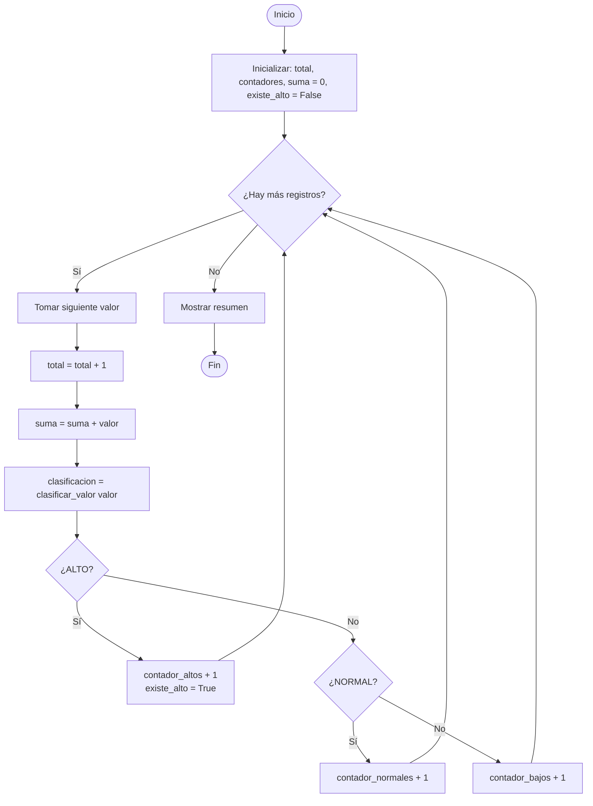

# DataLab v0.6 — Documentación Semana 6

**Curso:** Lógica Computacional · **Tema:** Contadores, acumuladores y banderas

> **Supuesto:** `clasificar_valor()` usa ALTO ≥ 70, BAJO < 30, NORMAL el resto.
> Si tus umbrales son otros, ajusta los datos de los retos 6, 7, 8 y los casos de prueba.

---

## Resumen de retos (código en `datalab_v06.py`)

| Reto | Qué hace | Resultado |
|------|----------|-----------|
| 1 | Contador de registros | `Registros procesados: 5` |
| 2 | Contadores por categoría | ALTO 1, NORMAL 3, BAJO 1 (suma 5 = TOTAL) |
| 3 | Acumulador | `Suma de valores: 150` |
| 4 | Bandera de existencia | `¿Existe algún ALTO?: True` |
| 5 | Resumen combinado | Total 5, ALTO 1, NORMAL 3, BAJO 1, Suma 250.0, True |
| 6 | Sin ALTO | `[40, 50, 45, 55, 60]` → ALTO 0, BAJO 0, bandera False |
| 7 | Un solo ALTO | `[40, 50, 85, 45]` → ALTO 1, bandera True |
| 8 | Datos mixtos | `[85, 50, 20, 90, 45, 10]` → manual = programa |
| 9 | Error de inicialización | Corregido |
| 10 | Integración | `procesar_registros()` + `mostrar_resumen()` |
| Final | DataLab v0.6 | Resumen completo |

### Reto 6 — ¿Por qué la bandera no cambia?
La bandera solo pasa a `True` dentro del `if` que detecta un ALTO. Si ningún valor es ALTO, ese bloque nunca se ejecuta y la bandera conserva su valor inicial `False`.

### Reto 7 — ¿En qué iteración cambia?
En la **iteración 3** (valor `85`). Antes era `False`; desde ahí queda en `True` aunque la iteración 4 sea NORMAL (nada la regresa a `False`).

### Reto 8 — Cálculo manual (datos `[85, 50, 20, 90, 45, 10]`)

| Concepto | Manual | Programa | ¿Coincide? |
|----------|--------|----------|-----------|
| Total | 6 | 6 | ✔ |
| ALTO (85, 90) | 2 | 2 | ✔ |
| NORMAL (50, 45) | 2 | 2 | ✔ |
| BAJO (20, 10) | 2 | 2 | ✔ |
| Suma (85+50+20+90+45+10) | 300 | 300 | ✔ |
| Existe ALTO | True | True | ✔ |

### Reto 9 — Error de inicialización

```python
for valor in valores:
    contador_altos = 0          # ← ERROR
    if clasificacion == "ALTO":
        contador_altos += 1
```

1. **Problema:** `contador_altos = 0` está dentro del ciclo.
2. **Por qué no conserva información:** en cada vuelta vuelve a 0, borrando lo acumulado. Al final solo vale 0 o 1 (según el último registro).
3. **Dónde inicializar:** **antes** del ciclo.
4. **Corrección:**

```python
contador_altos = 0              # una sola vez, antes del ciclo
for valor in valores:
    if clasificar_valor(valor) == "ALTO":
        contador_altos += 1
```

---

## Pseudocódigo actualizado (v0.6)

```text
INICIO
  total ← 0
  contador_altos ← 0
  contador_normales ← 0
  contador_bajos ← 0
  suma_valores ← 0
  existe_alto ← FALSO

  PARA CADA valor EN valores HACER
      total ← total + 1
      suma_valores ← suma_valores + valor
      clasificacion ← clasificar_valor(valor)

      SI clasificacion = "ALTO" ENTONCES
          contador_altos ← contador_altos + 1
          existe_alto ← VERDADERO
      SINO SI clasificacion = "NORMAL" ENTONCES
          contador_normales ← contador_normales + 1
      SINO
          contador_bajos ← contador_bajos + 1
      FIN SI
  FIN PARA

  MOSTRAR resumen
FIN
```

## Diagrama de flujo actualizado



---

## Casos de prueba (resultados reales de la ejecución)

| # | Escenario | Datos | Esperado | Obtenido | ¿Exitosa? |
|---|-----------|-------|----------|----------|-----------|
| 1 | Todos NORMAL | `[40, 50, 45]` | ALTO = 0 | ALTO 0, NORMAL 3, BAJO 0 | Sí |
| 2 | Un ALTO | `[40, 85, 50]` | ALTO = 1 | ALTO 1, bandera True | Sí |
| 3 | Varios ALTO | `[75, 80, 90, 40]` | ALTO = 3 | ALTO 3, NORMAL 1 | Sí |
| 4 | Todos BAJO | `[5, 10, 15]` | BAJO = TOTAL | BAJO 3, TOTAL 3 | Sí |
| 5 | Datos mixtos | `[85, 50, 20, 90, 45, 10]` | 2 / 2 / 2 | 2 / 2 / 2 | Sí |
| 6 | Datos conocidos | `[10, 20, 30, 40, 50]` | Suma = 150 | Suma 150 | Sí |

**6 de 6 pruebas exitosas.** En todas se verificó además `ALTO + NORMAL + BAJO = TOTAL`.

---

## Preguntas de reflexión

1. **Contador vs. acumulador:** el contador suma una cantidad fija (normalmente +1) para saber *cuántas veces* ocurre algo; el acumulador suma el *valor* de cada elemento para obtener un total (ej. suma de mediciones).
2. **¿Por qué inicializar antes del ciclo?** Para que tengan un punto de partida definido y para que se conserven entre iteraciones. Sin inicializar dará error (`NameError`); si se inicializa dentro, se reinicia en cada vuelta.
3. **¿Qué resuelve una bandera?** Recuerda si un evento ocurrió al menos una vez durante el ciclo (sí/no), sin tener que guardar todos los datos ni volver a recorrerlos.
4. **Si un contador se reinicia dentro del ciclo:** pierde lo acumulado; al terminar solo refleja la última iteración, produciendo resultados incorrectos.
5. **¿Cómo verifiqué el resumen?** Calculando a mano los resultados esperados (Reto 8), comparándolos con la salida, ejecutando 6 casos de prueba y comprobando `ALTO + NORMAL + BAJO = TOTAL`.
6. **Relación entre categorías y total:** `ALTO + NORMAL + BAJO = TOTAL`. Cada registro cae en exactamente una categoría; si no cuadra, hay un error en la lógica.
7. **¿Por qué reutilizar `clasificar_valor()`?** Evita duplicar reglas: si cambia un umbral solo se modifica en un lugar, se reducen errores, el código es más corto y mantenible, y todo el sistema clasifica igual.

---

## Comandos Git sugeridos

```bash
git add datalab_v06.py DOCUMENTACION_DataLab_v06.md
git commit -m "feat: agrega contadores, acumulador y bandera en DataLab v0.6"
git commit -m "test: agrega 6 casos de prueba del resumen"
git commit -m "docs: actualiza pseudocódigo, diagrama y reflexión S06"
git push origin main
```

## Lista de verificación
- [x] Contador · [x] Acumulador · [x] Bandera
- [x] Variables inicializadas antes del ciclo y actualizadas dentro
- [x] `clasificar_valor()` reutilizada
- [x] Resumen automático y verificación `ALTO + NORMAL + BAJO = TOTAL`
- [x] Casos de prueba, pseudocódigo, diagrama y documentación
- [ ] Commits descriptivos y publicación en GitHub (hazlo tú con los comandos de arriba)

